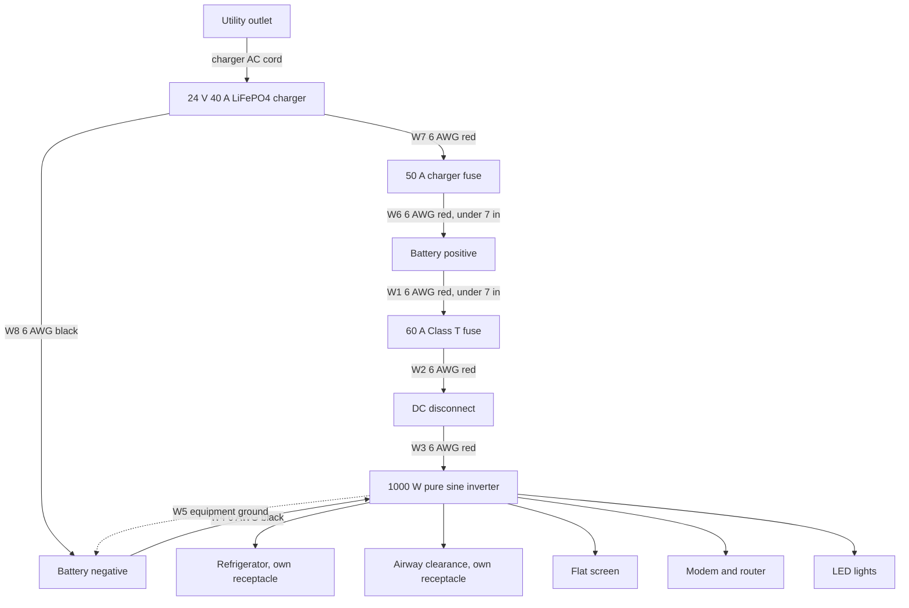

# 120 V battery backup design

Cord-and-plug backup for a refrigerator, a flat screen, internet gear, LED lights, and an airway-clearance device that clears phlegm. The inverter outlets feed the appliances. The charger is the only cord that plugs into a utility outlet. The inverter output is not tied to house wiring.

This is a planning design. The inverter manual, and an electrician for any later connection to house wiring, override the cable and fuse sizes below.

## Loads

Full-day profile. Refrigerator hours are compressor-on time, not hours the door stays closed. Flat-screen hours are viewing time. The modem and router stay on for the whole day. Airway-clearance hours are treatment time, not hours the machine sits plugged in.

| Load | Running | Start | Hours | Energy |
|---|---:|---:|---:|---:|
| Refrigerator | 180 W | 1,200 W | 8 | 1.44 kWh |
| LED lights | 60 W | 60 W | 8 | 0.48 kWh |
| Flat screen | 100 W | 150 W | 6 | 0.60 kWh |
| Internet modem and router | 25 W | 30 W | 24 | 0.60 kWh |
| Airway clearance (vest or cough assist) | 250 W | 400 W | 1 | 0.25 kWh |
| **Total** | **615 W** | **1,635 W** | | **3.37 kWh** |

The start figure is the refrigerator compressor starting while the flat screen, lights, internet gear, and airway-clearance device stay on.

A flat screen is often 60–150 W. Change the 100 W figure to the label on the set. A modem plus Wi-Fi router is often 15–30 W. Powering that gear only helps while the cable or fiber network outside the house still has power.

The medical load is the plug-in machine that clears phlegm. A chest vest (The Vest, SmartVest, InCourage, and similar) is often 150–400 W while the compressor runs. A cough-assist machine is often up to about 300–400 W, in short cycles. One hour covers a normal day of treatments, for example three sessions of about 20 minutes. A compressor nebulizer is often 50–130 W for 15–20 minutes a treatment, and a portable suction unit is often 70–180 W. If the nameplate is only a nebulizer, drop this row to that wattage. The same inverter and battery still cover it.

Read watts from the label. Give the airway-clearance device its own inverter receptacle, and run one full treatment on this backup before an outage. If that device has its own battery, keep the battery charged and use it for a treatment so a fridge start cannot interrupt therapy. Follow the device manual if it limits inverter or generator power. A household inverter does not replace the outage plan from the prescribing clinician.

An oxygen concentrator is not in this profile. A stationary unit is often 300–600 W and, left on all day, sets the battery size. A ventilator or other life-support device needs the backup plan from the prescribing clinician, including the device battery and any required cylinders. A CPAP with humidifier, often 60–90 W overnight, is also left out. Adding that all-night CPAP (about 0.56 kWh) pushes the day to about 3.93 kWh, past the 3.80 kWh this 200 Ah bank delivers at the outlets. Use a 24 V 280 Ah battery if both the CPAP and the airway-clearance device have to run.

## What to buy

| Item | Specification |
|---|---|
| Inverter | 1,000 W continuous, pure sine, 24 V DC to 120 V 60 Hz, surge at least 1,635 W, UL 1741 or UL 458, NEMA 5-15 receptacles |
| Battery | 24 V, 200 Ah LiFePO4 with a BMS (4.8 kWh nameplate). One 24 V battery, or two matched 12 V 200 Ah batteries in series |
| Main fuse | 60 A Class T, within 7 in of the battery positive |
| DC disconnect | DC-rated battery switch, at least 60 A, between the fuse and the inverter |
| Inverter cables | 6 AWG copper, 105°C |
| Charger | 24 V, 40 A, LiFePO4 charge profile. AC cord stays in a utility outlet |
| Charger fuse | 50 A, high-interrupt, within 7 in of the battery positive |
| Charger cables | 6 AWG copper |

Inverter losses are taken as 88%. LiFePO4 usable capacity is taken as 90%. The bank then delivers about 3.80 kWh at the outlets, about 13% above this profile. If every load stayed on together, runtime is about 6.2 hours. The airway-clearance device is off most of the day, so a real outage lasts longer than that simultaneous figure.

Calculated battery minimum is 177 Ah at 24 V. Buy 200 Ah.

## Wiring

The symbol schematic is in [backup-schematic.canvas.tsx](backup-schematic.canvas.tsx). F1 is the 60 A Class T fuse, F2 is the 50 A charger fuse, S1 is the DC disconnect, U1 is the inverter, and G1 is the charger.

W6 lands on the battery positive post, on the battery side of the 60 A fuse, so the charger has its own fuse. The refrigerator and the airway-clearance device each use their own inverter receptacle. The flat screen, modem, router, and lights may share a 15 A strip.

| Wire | Conductor | From | To |
|---|---|---|---|
| W1 | 6 AWG red, under 7 in | Battery positive | Class T fuse, line side |
| W2 | 6 AWG red | Class T fuse, load side | DC disconnect |
| W3 | 6 AWG red | DC disconnect | Inverter Bat+ |
| W4 | 6 AWG black | Battery negative | Inverter Bat− |
| W5 | Equipment ground, size in the inverter manual | Inverter ground lug | Battery negative |
| W6 | 6 AWG red, under 7 in | Battery positive | Charger fuse |
| W7 | 6 AWG red | Charger fuse | Charger DC+ |
| W8 | 6 AWG black | Battery negative | Charger DC− |
| AC | Charger factory cord | Utility outlet | Charger AC input |

Leave the inverter neutral-ground bond in the standalone position the manual specifies. Do not use a cord with a male plug on both ends. Do not plug the inverter into a wall outlet.

### Series batteries

Skip the jumper if you buy one 24 V battery. To build 24 V from two matched 12 V 200 Ah batteries, connect the negative of one to the positive of the other with about 12 in of 6 AWG. The free positive and the free negative are the bank posts. Same model, age, and capacity. Do not parallel those posts.

### Landing order

1. Disconnect open, both fuses out.
2. Crimp and land every lug. Red only on positives, black only on negatives.
3. Measure DC voltage on inverter Bat+ and Bat−. It must match the battery, positive on Bat+.
4. Insert the fuses, close the disconnect with the outlets empty, and confirm about 120 V.
5. Plug in the refrigerator, then the airway-clearance device, then the flat screen, the internet gear, and the lights. Run one treatment while the refrigerator is plugged in.
6. Plug the charger into a utility outlet, not into the inverter.

Torque each stud to the hardware listing. A loose DC lug is a fire source.

Parts and prices are in [BOM.md](BOM.md).
